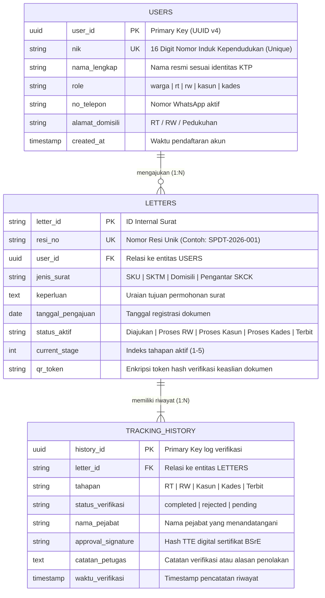

# Sistem Persuratan Digital Terintegrasi (SPDT)

[%202026-800020?style=for-the-badge&logo=target)](https://github.com)
[](https://github.com)
[](https://react.dev)
[](https://nodejs.org)
[](https://github.com)

> **Karya Inovasi Kompetisi Multimedia In Action (MIA) 2026**  
> **Subtema**: *Public Service Tracking*  
> **Fokus Solusi**: Transformasi Birokrasi Layanan Kependudukan Desa Berbasis Pelacakan Real-Time & Tanda Tangan Elektronik Sah

---

## 📌 Deskripsi Singkat

**Sistem Persuratan Digital Terintegrasi (SPDT)** adalah portal administrasi kependudukan desa satu pintu (*one-stop village administration*) yang memfasilitasi pengajuan surat mandiri oleh warga dengan pelacakan status berkas secara *real-time* berbasis nomor resi unik, serta mekanisme otorisasi Tanda Tangan Elektronik (TTE) berjenjang berkekuatan hukum sah.

Platform ini memangkas mata rantai birokrasi manual yang lambat, rentan pungli, dan rawan kehilangan arsip fisik menjadi ekosistem digital terpadu yang transparan, akuntabel, dan inklusif bagi seluruh lapisan masyarakat pedesaan.

---

## 🎯 Latar Belakang & Nilai Inovasi

### 1. Eliminasi Birokrasi Bolak-Balik (*Zero Physical Queuing*)
Pada sistem konvensional, warga desa harus meluangkan waktu berhari-hari hanya untuk mendatangi kediaman Ketua RT, Ketua RW, Kepala Dusun, dan Kantor Balai Desa demi meminta stempel basah serta tanda tangan fisik. SPDT mentransformasi seluruh tahapan tersebut ke dalam sistem digital mandiri yang dapat diakses 24 jam langsung dari smartphone warga.

### 2. Pelacakan Publik 5 Tahap Real-Time (*Public Service Tracking*)
Setiap permohonan yang diajukan langsung memperoleh kode pelacakan unik (Nomor Resi digital). Warga dan perangkat desa dapat memantau posisi dan kronologi berkas secara transparan melalui alur verifikasi 5 tahapan berjenjang:

$$\mathbf{Diajukan} \longrightarrow \mathbf{Ketua\ RT} \longrightarrow \mathbf{Ketua\ RW} \longrightarrow \mathbf{Kepala\ Dusun\ (Kasun)} \longrightarrow \mathbf{Kepala\ Desa\ (TTE)} \longrightarrow \mathbf{Dokumen\ Terbit\ Sah}$$

### 3. Tanda Tangan Elektronik (TTE) Berstandar BSrE & Verifikasi QR Code
Dokumen yang disahkan tidak lagi memerlukan tanda tangan basah yang rentan dipalsukan. SPDT menerapkan Tanda Tangan Elektronik (TTE) tersertifikasi standar Balai Sertifikasi Elektronik (BSrE) yang dilengkapi kode QR dinamis pada lembar dokumen cetak untuk validasi keaslian dokumen secara instan oleh instansi luar (perbankan, kepolisian, dinas sosial).

### 4. Desain Inklusif Mobile-First & Akun Pendamping
Menjawab kesenjangan literasi digital pada kelompok lansia atau warga rentan, SPDT menghadirkan arsitektur desain *mobile-first* yang ringan, ergonomis, ber-kontras tinggi, dilengkapi fitur bukti pendaftaran otomatis via WhatsApp (*one-click share*), serta mekanisme akun pendamping keluarga untuk memfasilitasi permohonan atas nama anggota keluarga lain.

---

## 💻 Tech Stack Breakdown

SPDT dibangun dengan arsitektur *Full-Stack Monorepo* yang memisahkan tanggung jawab *client presentation* dan *business logic service* secara modular, tangguh, dan siap diskalakan.

### Frontend
- **Library & Framework**: [React 18](https://react.dev/) (Functional Components & Hooks Architecture)
- **Build Tool & Bundler**: [Vite](https://vitejs.dev/) (Lightning-fast HMR & optimized production bundling)
- **Styling & Design System**: [Tailwind CSS v3](https://tailwindcss.com/) dengan palet custom Classic Burgundy (`#800020`), Dark Slate, dan PostCSS
- **Routing**: [React Router DOM v6](https://reactrouter.com/) (SPA Client-side Routing)
- **Iconography**: [Lucide React](https://lucide.dev/) (Clean, consistent SVG vector icons)
- **HTTP Client**: Native Fetch API terintegrasi dengan modul layanan terabstraksi (`api.js`)

### Backend
- **Runtime Environment**: [Node.js](https://nodejs.org/) (ES Modules / modern import syntax)
- **Web Framework**: [Express.js v4](https://expressjs.com/) (RESTful API Server)
- **Cross-Origin Resource Sharing**: `cors` middleware untuk pengamanan pertukaran data lintas domain
- **Static Asset Serving**: Express static built-in middleware untuk mendistribusikan berkas produksi React SPA
- **Process Manager**: [PM2](https://pm2.keymetrics.io/) untuk *zero-downtime clustering*, auto-restart, dan daemon background service

---

## 📁 Struktur Direktori Proyek

```ascii
spdt/
├── backend/
│   ├── controllers/
│   │   └── letterController.js   # Logika bisnis: pembuatan surat, validasi NIK, & approval TTE berjenjang
│   ├── routes/
│   │   └── letters.js            # Definisi endpoint RESTful (GET /:id, GET /, POST /, POST /:id/approve)
│   ├── package.json              # Konfigurasi dependensi dan script backend
│   └── server.js                 # Entry point Express API & static SPA handler (Port 5001)
│
├── frontend/
│   ├── public/                   # Asset statis, favicon desa, dan manifest
│   ├── src/
│   │   ├── components/
│   │   │   ├── Footer.jsx         # Komponen footer identitas resmi desa & kanal aduan
│   │   │   └── TrackingWidget.jsx # Widget pelacakan nomor resi dengan visual stepper dinamis
│   │   ├── layouts/
│   │   │   └── PublicLayout.jsx   # Shell layout: navigasi sticky glassmorphism & outlet SPA
│   │   ├── pages/
│   │   │   ├── LandingPage.jsx    # Hero section, alur zig-zag 6 langkah, & visual roadmap
│   │   │   ├── PortalPetugas.jsx  # Workspace approval & otorisasi TTE multi-role (RT, RW, Kasun, Kades)
│   │   │   ├── PortalWarga.jsx    # Formulir pengajuan surat, validasi 16 digit NIK, & tanda bukti resi
│   │   │   └── UserDashboard.jsx  # Tampilan riwayat pengajuan mandiri warga
│   │   ├── services/
│   │   │   └── api.js             # Abstraksi koneksi client API backend
│   │   ├── App.jsx                # Router utama dan pemetaan rute aplikasi
│   │   ├── index.css              # Directive Tailwind CSS & custom ambient glow styling
│   │   └── main.jsx               # Bootstrap React DOM rendering
│   ├── index.html                 # HTML template root Vite
│   ├── package.json               # Dependensi client-side & UI libraries
│   ├── postcss.config.js          # Pipeline PostCSS
│   ├── tailwind.config.js         # Konfigurasi tema warna burgundy, tipografi, & breakpoints
│   └── vite.config.js             # Konfigurasi dev server & production bundling
│
├── ecosystem.config.js            # Konfigurasi PM2 Process Manager untuk server produksi
└── README.md                      # Dokumentasi teknis proyek
```

---

## 🗄️ Database Schema Structure

Untuk memenuhi standar kelayakan review teknis dan evaluasi arsitektur data, SPDT dirancang menggunakan skema relasional 3-entitas utama yang menunjang audit berkas persuratan (*audit-trail compliance*):



### Penjelasan Relasi & Integritas Data
1. **`USERS` $\to$ `LETTERS` (One-to-Many)**: Satu pemohon/warga yang terverifikasi melalui NIK 16 digit dapat mengajukan banyak permohonan surat kependudukan sesuai kebutuhan administratifnya.
2. **`LETTERS` $\to$ `TRACKING_HISTORY` (One-to-Many)**: Setiap satu berkas permohonan memiliki catatan riwayat tahapan berurutan (*chronological audit trail*). Hal ini memastikan bahwa tahapan persetujuan dari RT, RW, Kasun, hingga tanda tangan elektronik Kades tersimpan secara permanen dan tidak dapat dimanipulasi.

---

## 🚀 Panduan Instalasi & Menjalankan Sistem Lokal

Pastikan lingkungan komputer/server Anda telah terpasang:
- **Node.js**: Versi `>= 18.0.0`
- **npm**: Versi `>= 9.0.0`
- **Git**

### 1. Clone Repository Proyek
```bash
git clone https://github.com/username/spdt.git
cd spdt
```

### 2. Menjalankan Backend API Server
Buka jendela terminal pertama:
```bash
# Masuk ke direktori backend
cd backend

# Instalasi seluruh dependensi backend
npm install

# Jalankan server Express (port default 5001)
npm start
# Atau mode development watcher:
npm run dev
```
> Server backend akan berjalan di: **`http://localhost:5001`**  
> Uji koneksi API: **`http://localhost:5001/api/health`**

### 3. Menjalankan Frontend Development (Vite)
Buka jendela terminal kedua:
```bash
# Masuk ke direktori frontend
cd frontend

# Instalasi seluruh dependensi frontend
npm install

# Jalankan Vite development server
npm run dev
```
> Akses antarmuka pengguna pada browser di: **`http://localhost:3000`** *(atau `http://localhost:3001` jika port 3000 sedang digunakan aplikasi lain)*.

### 4. Menjalankan Mode Produksi dengan PM2 (Opsional / Demo Server)
SPDT telah dilengkapi konfigurasi `ecosystem.config.js` untuk menjalankan frontend build dan backend API secara terpadu dalam satu port:
```bash
# Build frontend ke mode produksi
cd frontend && npm run build && cd ..

# Jalankan cluster via PM2 dari root direktori
pm2 start ecosystem.config.js
pm2 save
```
> Aplikasi langsung aktif di background port `5001` dan dapat diakses dari jaringan lokal maupun Tailscale.

---

## 🔍 Data Resi Contoh untuk Pengujian Penguji (Demo)

Untuk mempermudah dewan juri dan evaluator dalam menguji fungsi *Public Service Tracking* pada menu **Lacak Resi**, berikut adalah tabel data percontohan pengujian:

| Nomor Resi | Jenis Surat | Nama Pemohon | NIK Pemohon | Status Tahapan Saat Ini | Aksi Pengujian |
| :--- | :--- | :--- | :--- | :--- | :--- |
| **`SPDT-2026-001`** | Surat Keterangan Usaha (SKU) | Haji Ahmad Dahlan | `3201012304650001` | 🟢 **Terbit Sah** | Uji pelacakan status selesai & simulasi unduh PDF ber-QR |
| **`SPDT-2026-002`** | Surat Keterangan Domisili | Siti Aminah | `3201015609800003` | 🟡 **Menunggu Verifikasi Kasun** | Uji visual stepper di tahapan tengah (Dusun) |
| **`SPDT-2026-003`** | Surat Keterangan Tidak Mampu (SKTM) | Bambang Sudarsono | `3201011202720005` | 🔵 **Menunggu Verifikasi RT** | Login sebagai RT (`rt` / `123`) di Portal Petugas untuk verifikasi awal |

> 💡 **Kredensial Login Portal Petugas (`/portal-petugas`)**:
> - **Ketua RT**: Username `rt` | Password `123`
> - **Ketua RW**: Username `rw` | Password `123`
> - **Kepala Dusun**: Username `kasun` | Password `123`
> - **Kepala Desa**: Username `kades` | Password `123`

---

## 📊 Progress Pengembangan Saat Ini

- [x] **Fondasi Arsitektur Full-Stack**: Pemisahan modular antara backend Express dan client React dengan standardisasi data JSON.
- [x] **Mesin Pelacakan Publik (*Public Service Tracking*)**: Pencarian nomor resi instan dengan visualisasi alur berjenjang 5 tingkat yang adaptif di layar smartphone maupun desktop.
- [x] **Formulir Pengajuan Warga Mandiri**: Validasi ketat NIK 16 digit (*live counter*), pencegahan submission ganda, serta tanda bukti registrasi digital (*printable receipt*).
- [x] **Integrasi Notifikasi WhatsApp**: Format ringkasan resi dan link pelacakan langsung siap kirim via tautan WhatsApp API resmi.
- [x] **Workspace Persetujuan & TTE Petugas Desa**: Portal multi-role berjenjang (RT $\to$ RW $\to$ Kasun $\to$ Kades) dilengkapi mekanisme blokir persetujuan ganda (*idempotent verification*).
- [x] **Desain Berstandar Kompetisi**: Implementasi palet *Classic Burgundy* (`#800020`), tipografi *Plus Jakarta Sans*, kontras tinggi, dan *zero layout shift*.
- [x] **Kesiapan Server Produksi & Remote Access**: Konfigurasi deployment PM2 dan kompatibilitas akses multi-device via jaringan VPN Tailscale.

---

## 👥 Tim Pengembang

Proyek ini dirancang dan dikembangkan dengan dedikasi penuh untuk ajang kompetisi **Multimedia In Action (MIA) 2026**:

* **Pengembang**: Tim Inovasi Digital SPDT
* **Kategori**: Mahasiswa / Umum - Multimedia In Action 2026
* **Subtema**: *Public Service Tracking*
* **Tujuan**: Mendorong digitalisasi desa yang akuntabel, inklusif, dan bebas birokrasi berbelit demi kemajuan tata kelola pelayanan publik Indonesia.

---
*SPDT — Mengurus Surat Desa Cepat, Transparan, dan Tanpa Bolak-Balik.*
